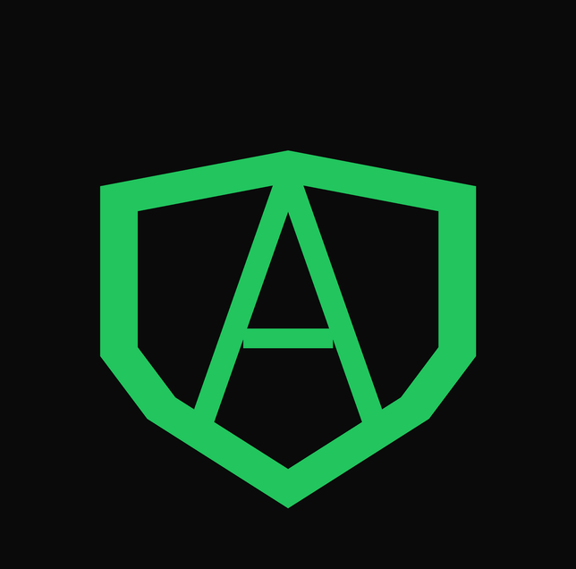
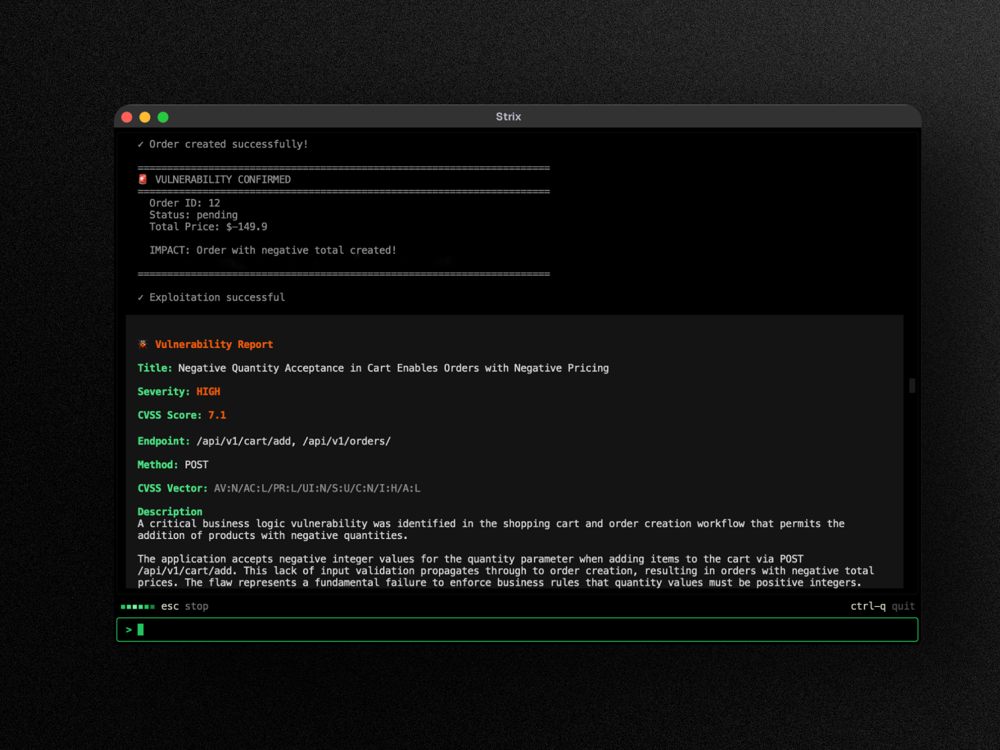

<p align="center">
  
</p>

<h1 align="center">AegisGuard</h1>

<p align="center">
  <strong>Multi-agent AI penetration testing from the command line.</strong><br>
  A customized, rebranded build of the open-source <a href="https://github.com/usestrix/strix">Strix</a> project.
</p>

<p align="center">
  
  
  
</p>

> [!IMPORTANT]
> **Attribution.** AegisGuard is a derivative work of **Strix**, created by the Strix authors
> (copyright 2025 OmniSecure Inc., Apache License 2.0). The agent architecture, tooling, tests and
> documentation originate from that project. This repository changes the product identity and
> packaging only; see [Credits](#16-credits-and-original-project-attribution),
> [`NOTICE`](NOTICE) and [`MODIFICATIONS.md`](MODIFICATIONS.md).

**Maintainer:** [Sadhasivam](https://github.com/Sadha-sivam) · <sadhasivam7172@gmail.com> · GitHub: [`Sadha-sivam`](https://github.com/Sadha-sivam)

---

## Table of contents

1. [Introduction](#1-introduction)
2. [Overview](#2-overview)
3. [Purpose and objectives](#3-purpose-and-objectives)
4. [Features](#4-features)
5. [Technical architecture](#5-technical-architecture)
6. [Technology stack](#6-technology-stack)
7. [Installation](#7-installation)
8. [Configuration](#8-configuration)
9. [Usage](#9-usage)
10. [Example workflows](#10-example-workflows)
11. [Screenshots](#11-screenshots)
12. [Security considerations](#12-security-considerations)
13. [Testing](#13-testing)
14. [Known limitations](#14-known-limitations)
15. [My contributions](#15-my-contributions)
16. [Credits and original project attribution](#16-credits-and-original-project-attribution)
17. [License](#17-license)

---

## 1. Introduction

AegisGuard is a command-line security tool in which teams of cooperating LLM-driven agents test an
application the way a human penetration tester would: they map the target, run tools inside an
isolated container, attempt to exploit suspected weaknesses, and keep only findings backed by a
reproducible proof of concept. Results are written to disk as structured reports.

## 2. Overview

Conventional static scanners flag patterns that may or may not be exploitable, which creates
triage work. AegisGuard instead pairs the model with a real toolchain (browser, intercepting
proxy, shell, scanners) and asks it to **validate** each suspected issue dynamically before
reporting it. It accepts local source directories, Git repositories and live URLs as targets, and
can run interactively (terminal UI) or headless for CI pipelines.

## 3. Purpose and objectives

- Reduce manual effort and false positives in application security testing.
- Provide a scriptable, CI-friendly way to run dynamic, exploit-validated assessments.
- Keep all findings on the local machine by default, with a local web viewer for review.
- Serve as a hands-on portfolio project demonstrating how an agentic security tool is configured,
  packaged, documented and operated responsibly.

## 4. Features

All features below are present in the source code inherited from Strix 1.7.1.

| Area | Capability |
|------|------------|
| Targets | Local directories, Git repositories (HTTPS/SSH), and live web URLs; multiple targets per run |
| Scan modes | `quick`, `standard`, `deep` (default) via `--scan-mode` |
| Scope control | `--scope-mode auto/diff/full` with `--diff-base` for pull-request (changed files) scans |
| Multi-agent orchestration | A root agent that spawns and coordinates child agents (`strix/agents`, `strix/tools/agents_graph`) |
| Agent tools | Browser automation, HTTP proxy (Caido), shell, patch application, notes, to-do list, threat modeling, coverage tracking, web search (Exa or Perplexity), MCP client, vulnerability reporting |
| Sandbox | Scans execute in a Docker container; default image `ghcr.io/usestrix/strix-sandbox` (configurable) |
| Knowledge base | Markdown "skills" under `strix/skills/` for vulnerability classes (SQLi, XSS, SSRF, IDOR, JWT, RCE, race conditions, business logic, LLM prompt injection, and more), frameworks, protocols, and reconnaissance |
| Reporting | Per-run output under `strix_runs/<run-name>`; SARIF export and PDF report modules; CVSS scoring; finding de-duplication |
| Local viewer | `strix view` serves a prebuilt web dashboard (overview, vulnerabilities, agent graph, steering) from run files |
| CI/CD | Headless mode (`-n`), `--fail-on <severity>` exit codes, GitHub Actions / GitLab / Jenkins examples in `docs/integrations/` |
| LLM providers | Routed through LiteLLM / OpenAI Agents SDK: OpenAI, Anthropic, Azure, Bedrock, Vertex, OpenRouter, Vercel AI Gateway, local models, and others (see `docs/llm-providers/`) |
| Cost controls | `--max-budget` limits and usage/cost tracking |
| Resume | `--resume` continues a prior run |
| Optional cloud client | `strix cloud ...` talks to the **upstream Strix** managed service; it is not part of AegisGuard's own functionality |

## 5. Technical architecture

```text
  CLI (strix / aegisguard)          Go terminal UI (Bubble Tea sidecar)
            │                                   │
            └──────────────┬────────────────────┘
                           ▼
        strix/interface   argument parsing, scan setup, TUI backend, local viewer (Python + prebuilt React SPA)
                           ▼
        strix/core        runner, sessions, execution loop, hooks
                           ▼
        strix/agents      root + child agent factory, prompts, skills loading
                           ▼
        strix/tools       browser · proxy · shell · notes · todo · threat_model · coverage · MCP · reporting …
                           ▼
        strix/runtime     Docker sandbox client, Caido bootstrap, session manager
                           ▼
        strix/report      state, de-duplication, coverage, SARIF, PDF, run summaries
        strix/llm  strix/config  strix/telemetry  (model routing, settings, optional analytics)
```

The Python import package is still named `strix`; see [`MODIFICATIONS.md`](MODIFICATIONS.md) for
why internal identifiers were intentionally left unchanged.

## 6. Technology stack

- **Python 3.12+** – core application (Pydantic, Rich, Docker SDK, LiteLLM, OpenAI Agents SDK, ReportLab, `caido-sdk-client`)
- **Go** – Bubble Tea terminal-UI sidecar (`strix/interface/tui`)
- **TypeScript / React / Vite** – local results viewer (source in `strix/interface/viewer/frontend`, prebuilt bundle in `.../static`)
- **Docker** – isolated sandbox for tools and targets; Kali-based image definition in `containers/Dockerfile`
- **Tooling** – `uv`, `hatchling`, `pytest`, `ruff`, `mypy`, `bandit`, `pre-commit`, GitHub Actions

## 7. Installation

**Prerequisites:** Python 3.12+, **Go 1.24+** (the package build compiles the terminal-UI sidecar and
fails without it), Docker (running), `uv` or `pipx`, and an API key for a supported LLM provider.

```bash
git clone https://github.com/Sadha-sivam/AegisGuard.git
cd AegisGuard

# Option A: install as a tool (builds the Go TUI sidecar into the wheel)
pipx install .

# Option B: development environment (editable; the TUI runs from source with `go run`)
uv sync
```

Two equivalent commands are installed: `aegisguard` (branded alias) and `strix` (original name,
used throughout the documentation and examples).

> [!WARNING]
> Do **not** use `strix --update` or the upstream `strix.ai/install` script on this fork: they
> fetch upstream Strix releases and would replace AegisGuard. Pull updates from your own repository.

## 8. Configuration

Settings come from environment variables, then `~/.strix/cli-config.json`, then defaults. Copy
[`.env.example`](.env.example) as a reference and export the variables in your shell (the file is
a template; the application does not load it automatically). Never commit real keys.

| Variable | Purpose |
|----------|---------|
| `STRIX_LLM` | Model identifier, e.g. `openrouter/z-ai/glm-5.3` |
| `LLM_API_KEY` | Provider API key |
| `LLM_API_BASE` | Optional custom endpoint (local models) |
| `STRIX_IMAGE` | Sandbox image (default `ghcr.io/usestrix/strix-sandbox:1.4.1`) |
| `STRIX_TELEMETRY` | Set to `0` to disable anonymous telemetry (enabled by default) |
| `STRIX_NO_UPDATE_CHECK` | Set to `1` to stop version checks against upstream |
| `PERPLEXITY_API_KEY` / `EXA_API_KEY` | Optional web-search providers |

Full reference: [`docs/advanced/configuration.mdx`](docs/advanced/configuration.mdx).

## 9. Usage

```bash
aegisguard --target ./app-directory                       # interactive, deep scan
aegisguard --target https://staging.example.com           # live URL
aegisguard -n -t ./app --scan-mode quick --fail-on high   # headless, CI-style
aegisguard --target ./app --instruction "Focus on authentication and IDOR"
aegisguard view                                           # open the latest run in the local viewer
aegisguard --resume <run-name>                            # continue a run
```

Run `aegisguard --help` for every option. Headless exit codes: `0` no findings (or none at or
above `--fail-on`), `1` fatal error, `2` vulnerabilities found. Details: [`docs/usage/cli.mdx`](docs/usage/cli.mdx).

## 10. Example workflows

1. **Pre-release review of your own app:** run a `deep` scan against a staging URL plus its source
   directory, then review findings with `aegisguard view`.
2. **Pull-request gate:** run `-n --scan-mode quick --scope-mode diff --fail-on high` in CI to
   block merges with high-severity, validated issues (see `docs/integrations/github-actions.mdx`).
3. **Targeted retest:** use `--instruction` to focus agents on one area after a fix.

## 11. Screenshots

<p align="center">
  
</p>

*Interface capture from the upstream Strix project. AegisGuard keeps this interface, but the
window title in this image still reads "Strix" because it was not recaptured from an AegisGuard
build. Replace it with your own capture once you have run the tool.*

## 12. Security considerations

- **Authorized use only.** Test only systems you own or have explicit written permission to test.
  Agents execute real exploit attempts.
- **Isolation.** Tool execution happens in a Docker sandbox, but a container is not a perfect
  security boundary; do not point scans at production data you cannot afford to affect.
- **LLM data flow.** Prompts, tool output and code excerpts are sent to the LLM provider you
  configure. Use a provider and region that fit your confidentiality requirements.
- **Telemetry (inherited, on by default).** Anonymous usage data is sent to the upstream
  project's PostHog and Scarf endpoints. Disable with `STRIX_TELEMETRY=0`; behavior is described
  in `strix/telemetry/README.md`.
- **Upstream network calls.** Update checks (GitHub/PyPI), the `strix cloud` commands, and the
  viewer's email-report and feedback features contact upstream Strix services. Set
  `STRIX_NO_UPDATE_CHECK=1` and avoid those features if you want no upstream traffic.
- **ChatGPT-subscription sign-in (inherited, unverified terms).** `aegisguard auth login chatgpt`
  authenticates using OpenAI's Codex CLI OAuth client identifiers (see `strix/config/codex.py`).
  Whether that is permitted by OpenAI's terms is unverified; prefer a normal provider API key.
- **Secrets.** Keep API keys in the environment or `~/.strix/cli-config.json` (outside the repo).
  `.gitignore` excludes `.env*` files and `strix_runs/`. Scan reports can contain sensitive data.

## 13. Testing

```bash
uv sync
uv run pytest            # Python test suite in tests/
make tui-test            # Go TUI tests (requires Go)
make check-all           # ruff, mypy, bandit
```

**Validation status of this packaged archive:** the rebranding was prepared in an offline
sandbox with no network access, so dependencies could not be installed and **the test suite, the
application, the Docker sandbox and agent execution were not run**. Only static checks were
performed; see [`MODIFICATIONS.md`](MODIFICATIONS.md#validation-performed). Run the commands above
on your machine before publishing and record the results.

## 14. Known limitations

- Requires Docker and an LLM API key; scan quality and cost depend on the chosen model.
- LLM-driven testing is non-deterministic; findings need human review.
- Building from source needs a Go toolchain (the TUI sidecar is compiled during packaging).
- Some inherited text, commands, environment variables, the sandbox image name and the `strix`
  package name intentionally keep the original Strix identity.
- Commercial "Strix Cloud / Enterprise" prompts and endpoints in inherited code and the viewer UI
  refer to the upstream vendor, not to AegisGuard.
- The default sandbox image (`ghcr.io/usestrix/strix-sandbox`) is hosted by the upstream project;
  its availability and the licenses of its bundled tools are outside this repository. You can build
  your own from `containers/Dockerfile` and point `STRIX_IMAGE` at it.
- The release workflows in `.github/workflows` are upstream's and were not adapted or tested for
  this repository.

## 15. My contributions

This section lists only what the maintainer, Sadhasivam, actually changed or produced. It does
not include the upstream Strix implementation, which was written by the Strix authors.

| Contribution | Type |
|--------------|------|
| Rebranded CLI panel titles, `--help` text, headless hint, viewer title/header, terminal-UI splash strings, PDF report text and OAuth sign-in page | Code (branding strings only) |
| Added the `aegisguard` console-script alias, maintainer/URL metadata and package description in `pyproject.toml` | Packaging |
| Designed the AegisGuard shield logo and favicon | Design |
| Wrote the README, `NOTICE`, `MODIFICATIONS.md`, `AUDIT_REPORT.md`, `PORTFOLIO.md`, `.env.example` and `.gitignore` additions | Documentation |
| Replaced install instructions that pointed at upstream installers; documented upstream telemetry, update-check and cloud coupling | Documentation / configuration |
| Added Apache-2.0 §4(b) modification notices to changed files; audited licenses, assets and secrets | Compliance / security review |

Not yet done (add here if you do it): running the test suite, building the Go TUI, running real
scans, fixing bugs, adding features.

Maintainer: **Sadhasivam** · <sadhasivam7172@gmail.com> · [`Sadha-sivam`](https://github.com/Sadha-sivam)

## 16. Credits and original project attribution

AegisGuard is based on **Strix** — <https://github.com/usestrix/strix> — copyright 2025
OmniSecure Inc. and the Strix contributors, licensed under Apache 2.0. All original authorship
belongs to them. "Strix" and its logo are the property of their owners; AegisGuard is an
independent customization and is not affiliated with or endorsed by the Strix project. Third-party
components keep their own licenses (see `uv.lock`, `package-lock.json`, `go.sum`).

## 17. License

Distributed under the [Apache License 2.0](LICENSE), as the original work is. Required notices
are preserved in `LICENSE` and `NOTICE`, and modifications are stated in
[`MODIFICATIONS.md`](MODIFICATIONS.md).
